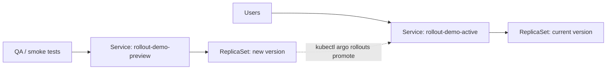

# Blue-Green Deployment with Argo Rollouts

Zero-downtime releases on Kubernetes. A new version is deployed next to the live one, tested on
a **preview** service, and only receives production traffic after a **manual promotion**.
Rollback is instant, because the previous version stays up until the new one is promoted.



## What's inside

| File | Purpose |
|---|---|
| `k8s/namespace.yaml` | `demo-app` namespace |
| `k8s/rollout.yaml` | Argo Rollouts `Rollout` with `blueGreen` strategy, 2 replicas, `autoPromotionEnabled: false` |
| `k8s/services.yaml` | `active` (production) and `preview` (new version) services |

The manifests are plain YAML, so they can be applied by hand or synced by a GitOps tool such as Argo CD.

## Run it locally (kind)

Requirements: Docker, [kind](https://kind.sigs.k8s.io/), `kubectl` and the
[Argo Rollouts kubectl plugin](https://argo-rollouts.readthedocs.io/en/stable/installation/#kubectl-plugin-installation).

```bash
# 1. Cluster + Argo Rollouts controller
kind create cluster --name bluegreen
kubectl create namespace argo-rollouts
kubectl apply -n argo-rollouts -f https://github.com/argoproj/argo-rollouts/releases/latest/download/install.yaml

# 2. Deploy the app (first version: green)
kubectl apply -f k8s/
kubectl argo rollouts get rollout rollout-demo -n demo-app --watch
```

## Release a new version

```bash
# Deploy "blue" next to the live version. Production traffic is untouched.
kubectl argo rollouts set image rollout-demo rollouts-demo=argoproj/rollouts-demo:blue -n demo-app

# Test it through the preview service (http://localhost:8081)
kubectl port-forward svc/rollout-demo-preview 8081:80 -n demo-app

# Happy? Switch production traffic to the new version
kubectl argo rollouts promote rollout-demo -n demo-app

# Not happy? Abort; production keeps running the current version
kubectl argo rollouts abort rollout-demo -n demo-app
```

Compare with the live version at any time:
`kubectl port-forward svc/rollout-demo-active 8080:80 -n demo-app`.

## Clean up

```bash
kind delete cluster --name bluegreen
```

## Roadmap

- Argo CD `Application` manifest so the cluster syncs from this repo (full GitOps loop)
- `AnalysisTemplate` to run automated smoke tests before promotion
